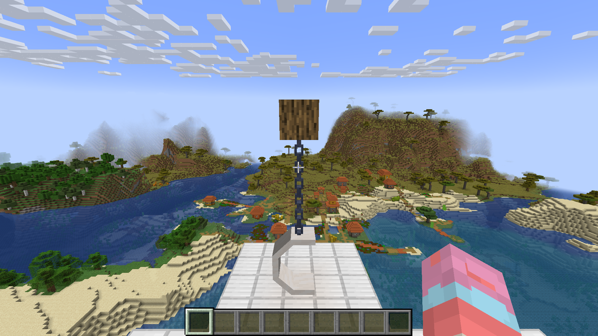

# Actual newer Flywheel and original swing native runtime

Actual Minecraft1.20.1/Forge47.4.26/Java17 on this computer passes **19 original-content checks using native Vulkan**, with Flywheel1.0.6-beta-266 actually selected. The eleven-JAR task-owned subset retains original Create, CasualSwing, Grassier Grass and required libraries/correctness content; all auxiliary optimizers are excluded during the test. The327-JAR full candidate is untouched and still blocks532 references/263 APIs in21 archives. No FPS was captured/accepted and no OpenGL fallback was launched. [Exact decision](SUMMARY.json), [actual result/counters/GPU controls](NATIVE-SMOKE.json), [pre-launch native gate](SUBSET-PREFLIGHT.json), [installed mod hashes](ACTIVE-MOD-SHA256.json).

## Original content and native selection

The tested stable Create14 copy has only its duplicate1.0.5 library/archive metadata record omitted in the disposable selection fixture; all Create gameplay/assets/other bundles stay exact. CasualSwing's unchanged private native archive supplies the real1.0.6. The original Create dependency remains satisfied; the controller asserts Forge's actual loaded version, native gate, native backend counters and active native recording before screenshots. This selection fixture is never installed in the full candidate. [Exact selection preservation](CREATE-TEST-SELECTION-MANIFEST.json).

The14 retained controls cover powered original machinery, lighting updates, resource reload and visual re-registration, original Ponder story/replay seek and config UI, actual native blit/stencil state, native GPU frustum visibility, rotating bearing contraption/embedding/disassembly and original breaking/cleanup. Six actual framebuffer GPU readback cases remain accepted. Five new controls cover the original two-half quartz moon seat/rope assembly with five synchronized parts, original registered SwingRopeRenderer, actual newer-library selection, original server/client seat interaction mounting/dismounting, and original asset/renderer preservation through a second resource reload. The result explicitly excludes arbitrary content, all seat variants, active swing amplitude/physics, full shader packs and complete pack parity.

Screenshots show the original chain/moon seat before and after reload. Powered machinery, Ponder/config UI and contraption images were visually inspected against the retained native14 reference where available; model/texture/layout content remains consistent with the bounded prior native scene. Rotating geometry and world time are not pixel-identical frame assertions. The swing is idle in both screenshots. `native_recording=false` in the swing lifecycle snapshots is recorded during ClientTick; actual screenshot capture separately requires active Vulkan command recording/renderpass before presentation.

Three preserved setup failures passed the14 newer-engine controls but stopped at the added swing fixture. They exposed an incorrect assembly expectation and ultimately the missing upper moon-seat half. The fixture now places both original halves, permits normal block-entity ticking and still requires all five parts and the original renderer/mount/cleanup behavior. No gameplay/rendering archive was changed or failed check removed. [Preserved failure decisions](PRESERVED-FIXTURE-FAILURES.json).

## Ownership, timing and remaining dependency

The original isolated cumulative active hashes/options/config are restored after normal client shutdown. Every full candidate active hash is unchanged; the original personal Noxviola/profile/worlds/accounts and other projects remain untouched. [Restoration proof](RESTORED.json). Source/runtime archives have format15 metadata and retained original notices. Only newly authored controller source/proofs are published; protected mod binaries remain private.

The repeated cached launch/Java-start timestamps and observed aggregate CPU/GPU utilization are retained in [normal exit/timing](DONE-CREATE.json), [GPU data](gpu.csv) and [CPU data](cpu.csv). External workloads stay running, so these diagnostic launches establish no matched startup/FPS/no-hitch gain. No benchmark study was duplicated.

Physics/Essential account for374 of the532 remaining static references. The exact pinned [production custom-program/fence diagnostic](NATIVE-PROGRAM-DEPENDENCY.json) rejects native acceptance from Hari's existing metadata-only generic program/fence adapters. Real custom shader/layout/draw/transfer/fence integration must precede additional contract acceptance. [Requested Beryl/Vulkan Essential downport source/licensing/dependency audit](../../../../compat/vulkan-shaders/DOWNPORT-STATUS-20261006.md) identifies reusable LGPL native upstream components and the author-source/permission needed for direct protected-addon ports. No addon, shader provider or compatibility claim is manufactured from changed version metadata.
